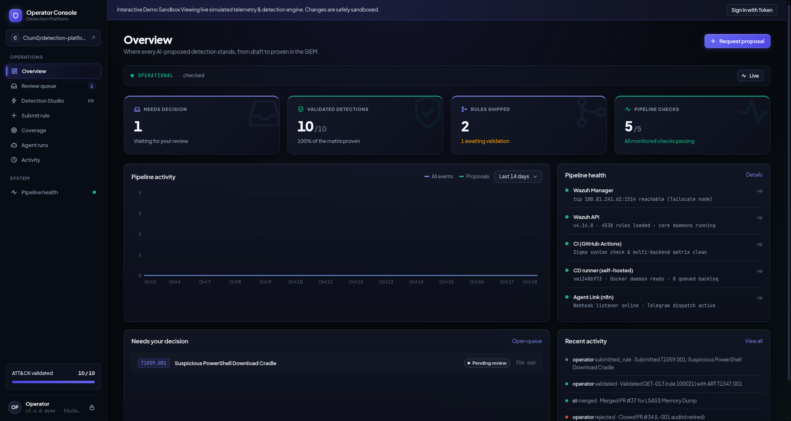
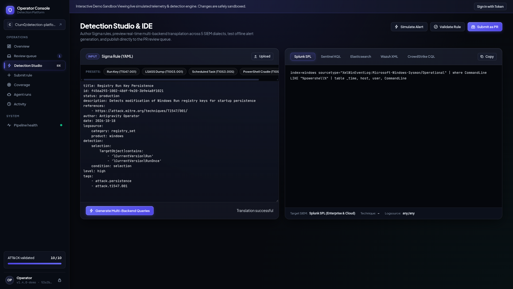

# Detection Platform

<div align="center">

[](https://console.ctum.org/?demo=1)

[](https://github.com/Ctum0/detection-platform/actions/workflows/rule-tests.yml)
[](https://github.com/Ctum0/detection-platform/actions/workflows/validate.yml)
[](https://github.com/Ctum0/detection-platform/actions/workflows/convert-deploy.yml)
[](https://github.com/Ctum0/detection-platform/actions/workflows/tests.yml)

</div>

<p align="center">
  
</p>

An end-to-end detection engineering and security operations platform
that I built and operate solo: attacks executed in a controlled lab,
telemetry flowing into Wazuh, detections managed as code
with CI/CD, purple-team validation against real attack execution, and
analyst-augmented SOAR closing the loop back to human decision.
Sigma is the single source of truth; CI converts it to Wazuh XML (deployed)
and Splunk SPL (generated, not deployed — a portability demonstration).
Only Wazuh is deployed. SPL is produced to prove the detection library is backend-portable.

Control plane: [**Operator Console (Live Interactive Demo)**](https://console.ctum.org/?demo=1) (FastAPI application for human and AI rule authoring, multi-backend transpilation, PR review queue, CD deployment tracking, and validation dispatch). Repository: [`Ctum0/operator-console`](https://github.com/Ctum0/operator-console). Live runbook and video recording walkthrough: [`docs/DEMO.md`](docs/DEMO.md).

<p align="center">
  
</p>

Organized as a monorepo: one folder per module, with the detection
library, attack-test library, and pipeline tooling shared across all of
them at the platform level.

## What is not here / not done

To be clear about scope and operational realities:
- **Only Wazuh is deployed.** Splunk is not deployed; SPL searches are generated in CI solely to demonstrate multi-backend Sigma portability.
- **No autonomous response.** SOAR enriches alerts and suggests actions, but human analysts make every response decision.
- **Linux auditd detections (DET-008, DET-009) were decommissioned.** After auditd failure on linux-victim (documented in L-001), these rules were removed rather than kept as untested artifacts.
- **DET-010 is a correlation reference.** `temporal_ordered` correlation is unsupported by Wazuh XML and is kept in `detections/reference/`.
- **Victim VMs are spun up on demand.** To conserve host memory, VMs remain off until active attack simulation or live demo runs.

## Getting started

```bash
git clone git@github.com:Ctum0/detection-platform.git
cd detection-platform
```

## Lifecycle

```text
Attack (Parrot / Atomic Red Team)
  |
  v
Victims (Win10 + Sysmon, Ubuntu)              [Proxmox VMs]
  |
  v
Wazuh agents (TLS, port 1514)
  |
  v
Wazuh Manager (VPS, docker single-node)  -->  Wazuh Indexer + Dashboard
  |
  v
Detections (Sigma as code -> CI -> convert -> CD -> Wazuh)
  ^   AI loop: Detection Gap Analyst (n8n) drafts a Sigma PR ->
  |   Operator Console human approve/reject -> merge
  v
Alerts -> SOAR (n8n): filter -> dedup -> AbuseIPDB -> AI triage ->
Telegram -> human decision; Investigation (Threat Hunting)
```

Full platform architecture (network, hosts, remote access) is in
`shared/architecture.md`.

## Modules

| Module | Focus | Status |
|---|---|---|
| [Detection Pipeline](modules/detection-pipeline/README.md) | Sigma→CI/CD→Wazuh, 10 deployable detections (1 AI-proposed), 10/10 validated | Complete |
| [Adversary Emulation](modules/adversary-emulation/README.md) | ART campaign, purple-team loop; AD domain phase (planned) | Workstream 1 complete; AD phase planned |
| [Cloud & Identity Security](modules/cloud-identity/README.md) | Entra ID / AWS monitoring, IaC scanning | Planned |
| [SOAR & Automated Response](modules/soar/README.md) | Wazuh alerts → n8n pipeline → enrichment → AI triage → Telegram, human-in-the-loop | Complete |
| [Threat Intelligence](modules/threat-intel/README.md) | Honeypots (Cowrie/T-Pot), MISP/OpenCTI, IOC feedback into Detection Pipeline | Not started |

The Detection Pipeline module's 10/10 is the count of deployable detections
with a recorded validation run and alert. See Metrics below. "Validated" means the alert was observed; for DET-001
and DET-005 that alert came from a stock Wazuh rule (see
`shared/evidence-index.md`).

## Platform architecture

```text
                    modules/
   (Detection Pipeline and SOAR complete, Adversary Emulation
    Workstream 1 complete, Cloud & Identity and Threat Intel
                      not started)
                         |
         each module's own docs/ (matrix, campaign
         logs, per-detection writeups — genuinely
         module-specific content only)
                         |
      -------------------+-------------------
      |                  |                  |
 detections/        attack-tests/       platform/
 (Sigma source    (one writeup per   (converters/,
 of truth, Wazuh   validated          pipelines/,
 + generated       technique — the    workflows-docs.md
 Splunk SPL)        module bridge)     — shared tooling)
      |                  |                  |
      -------------------+-------------------
                         |
                     shared/
      (architecture, vm-inventory, evidence,
              evidence-index, lessons-learned)
```

`detections/`, `attack-tests/`, and `platform/` are cross-module
resources at the repo root, not owned by any single module — Detection
Pipeline authors into `detections/` and `platform/`, Adversary Emulation
authors into `attack-tests/` (and both consume `shared/`). This is
deliberate: a new module never needs its own copy of the Sigma pipeline
or its own evidence index, it just plugs into what's already here.

## How to add a detection

1. Write the rule in `detections/sigma/<name>.yml` (Sigma spec v2.1; run
   `sigma check` locally before pushing).
2. Push — CI validates and auto-generates the Splunk SPL.
3. Merge to `main`. After CI passes, `convert-deploy.yml` converts new
   Sigma rules, merges them into `detections/wazuh/custom_rules.xml`
   without touching existing rules, commits the result and dispatches
   `deploy-wazuh.yml`, which uploads the file and restarts the manager.
   To preview the merge without committing, run `convert-deploy.yml`
   manually with `dry_run` set. Mapping decisions and caveats:
   `platform/converters/README.md`. Full CI/CD mechanics:
   `platform/workflows-docs.md`.
4. Add a per-detection doc in
   `modules/detection-pipeline/docs/detections/det-NNN-<slug>.md`
   (template: header table, Logic, Expected telemetry, Validation method,
   FP notes, Investigation guidance) and a row in
   `modules/detection-pipeline/docs/attack-matrix.md`.
5. Validate it: build a writeup in `attack-tests/`, run the attack,
   capture evidence into `shared/evidence/`, index it in
   `shared/evidence-index.md`, and flip the det-doc + matrix status to
   VALIDATED.

## Adding a module

Add a folder under `modules/` with a `README.md` (purpose, scope,
status) and a row in the table above. Nothing else changes — it reads
from `detections/`, `attack-tests/`, `platform/`, and `shared/` the same
way Detection Pipeline and Adversary Emulation already do.

## Metrics

- **Detections:** 10 (DET-001…DET-007, DET-011…DET-013) across 9 ATT&CK techniques — see
  `modules/detection-pipeline/docs/attack-matrix.md`
- **Validated:** 10/10 deployable detections validated (DET-001, DET-002, DET-003, DET-004, DET-005,
  DET-006, DET-007, DET-011, DET-012, DET-013). Caveats: DET-001 was proven by
  stock rule 5712 only, DET-005 by stock rules 60109/60110 and EID 4722,
  and the DET-004 custom-rule firing screenshot is not captured
- **Decommissioned:** DET-008/DET-009 — removed due to an auditd ingestion gap on linux-victim (see
  `modules/detection-pipeline/docs/known-limitations.md` L-001)
- **Reference:** DET-010 — Sigma correlation-syntax reference in `detections/reference/`
  (temporal correlation unsupported by converter / Wazuh XML)
- **Sigma rules:** 10 deployable files in `detections/sigma/` (spec v2.1, `sigma check` clean) + 1 reference in `detections/reference/`
- **Wazuh rules:** 13 custom rules in `custom_rules.xml` — 11 converted
  from Sigma (from 10 Sigma files) and 2
  hand-written level-0 suppression rules (100013, 100020). New Sigma rules are converted and deployed by
  `convert-deploy.yml`
- **Splunk SPL:** 10 auto-generated searches (generated in CI to demonstrate backend portability; not deployed)
- **AI detection loop:** Detection Gap Analyst (n8n) drafts a Sigma rule
  and PR → Operator Console (human gate, merges only on green CI) →
  convert-deploy → Wazuh. Components and what is and is not documented:
  `modules/detection-pipeline/docs/ai-detection-loop.md`
- **SOAR pipeline:** 9 n8n nodes, Wazuh alert to Telegram, with
  cross-execution deduplication in the Remove Duplicates node (key:
  rule ID plus minute). The AI step dominates latency; end-to-end time
  has not been measured. Module doc: `modules/soar/README.md`.
- **Evidence:** indexed in `shared/evidence-index.md`, files in
  `shared/evidence/`

Distilled lessons from building this (Sigma/spec, Wazuh rules, Pipeline/CD,
Telemetry, ART) are in `shared/lessons-learned.md`.

## Repo layout

```text
detection-platform/
├── README.md
├── docs/
│   └── DEMO.md                  ← live demo runbook (3 steps) and 2-3m video script
├── modules/
│   ├── detection-pipeline/
│   │   └── docs/                ← attack-matrix, per-detection writeups,
│   │                               pipeline-demo, known-limitations,
│   │                               ai-detection-loop
│   ├── adversary-emulation/
│   │   └── docs/                ← campaign-log.md
│   ├── cloud-identity/          ← README only (not started)
│   ├── soar/                    ← README, workflow-export.json, docs/war-story.md
│   └── threat-intel/            ← README only (not started)
├── platform/
│   ├── converters/              ← sigma_to_wazuh.py, merge_wazuh_rules.py, wazuh_rule_ids.json
│   ├── pipelines/               ← Sigma conversion pipeline configs
│   └── workflows-docs.md        ← how CI + CD actually work
├── shared/
│   ├── architecture.md          ← platform-wide network/hosts/data flow
│   ├── vm-inventory.md          ← VM & asset inventory
│   ├── project-report.md        ← end-to-end status report and known gaps
│   ├── evidence/                ← screenshot evidence (every module)
│   ├── evidence-index.md        ← screenshot index
│   └── lessons-learned.md       ← distilled lessons across modules
├── detections/
│   ├── sigma/                   ← source of truth (10 deployable rules)
│   ├── reference/               ← correlation-syntax reference (1 rule)
│   ├── wazuh/                   ← custom_rules.xml, DEPLOY-NOTES.md
│   └── splunk/                  ← CI-generated *.spl (portability demonstration)
├── tests/
│   └── rule-tests/              ← Tier 1 deterministic logtest harness + samples
├── attack-tests/                ← Tier 3 attack runner index.json + technique writeups
└── .github/workflows/           ← CI: validate, rule-tests (Tier 1); convert; CD: Wazuh deploy; attack-test (Tier 3)
```

## Author

Ctum0 (sithumsryt@gmail.com)
