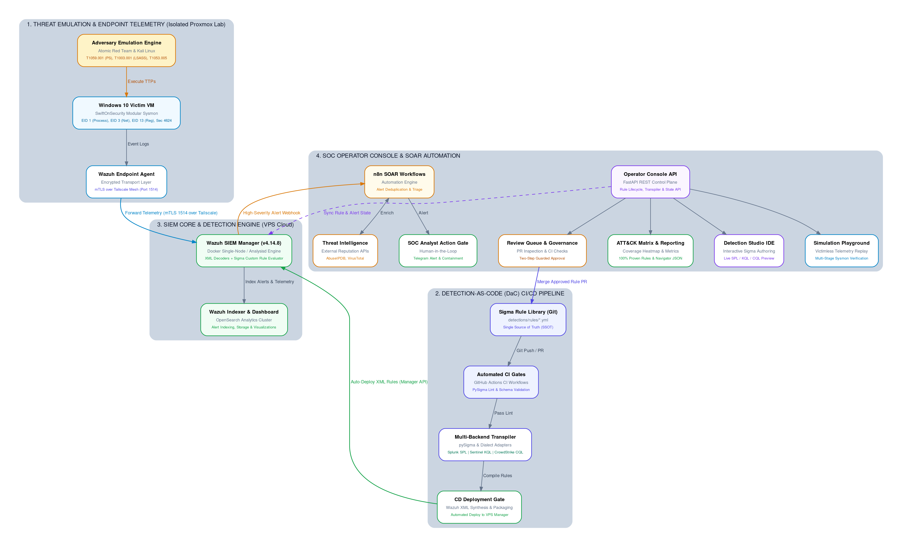
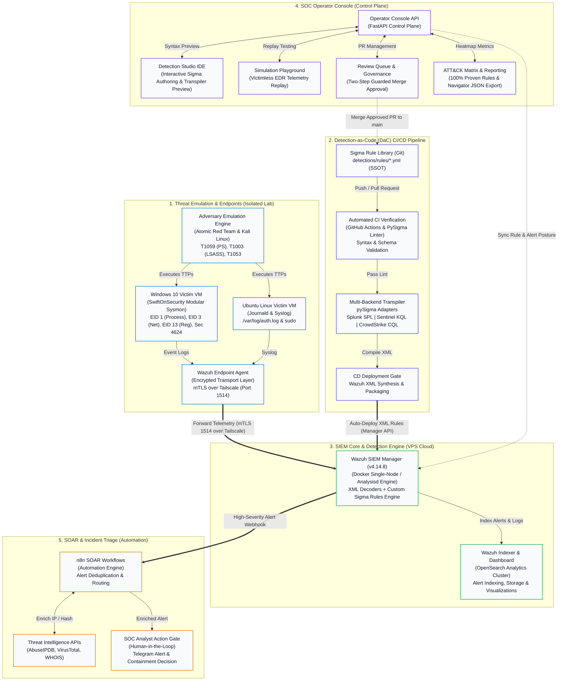

# Architecture

## Overview

An end-to-end detection engineering and security operations platform.
Attacks are run in an isolated lab, telemetry flows into Wazuh,
Sigma is the single source of truth; CI converts it to Wazuh XML (deployed)
and Splunk SPL (generated, not deployed — a portability demonstration).
Investigations are supported by automation and AI. Every response action stays with a human analyst.

Only Wazuh is deployed. SPL is produced to prove the detection library is backend-portable.

## Architecture Diagram

## Network

The lab runs on a private network. Victims and the hypervisor sit on a
home LAN, and remote administration and telemetry traverse a private
overlay network. Addresses are not published here.

Wazuh manager agent ports are bound to the Tailscale interface only; the API
is loopback-only.

## Components

| Component | Technology | Host |
|---|---|---|
| Hypervisor | Proxmox VE | Bare-metal server |
| Linux victim | Ubuntu 22.04 + Wazuh agent | VM |
| Windows victim | Windows 10 Pro + Sysmon (SwiftOnSecurity config) + Wazuh agent | VM |
| SIEM | Wazuh 4.14.8 (docker single-node) | VPS |
| SOAR | n8n (workflow automation) | VPS |
| Attacker | Parrot OS | Analyst laptop |
| Detection repository | GitHub | Cloud |
